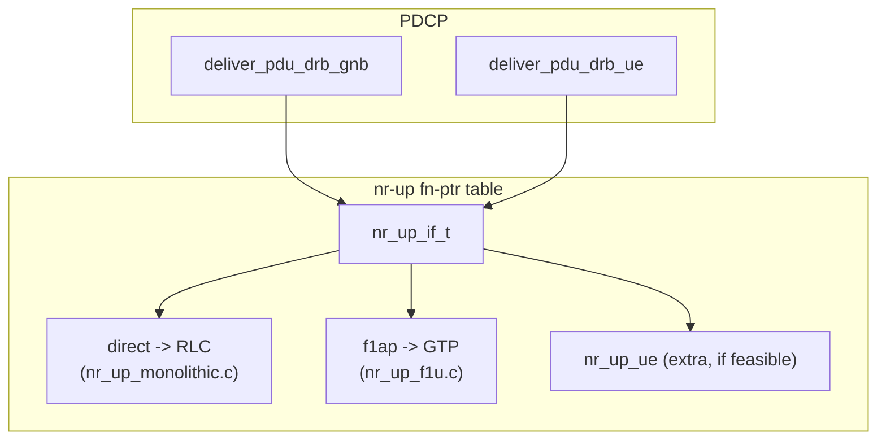
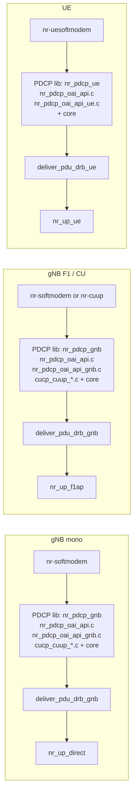
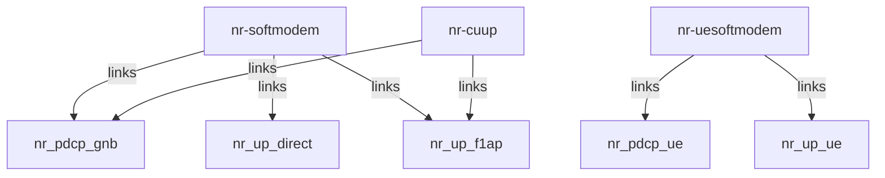
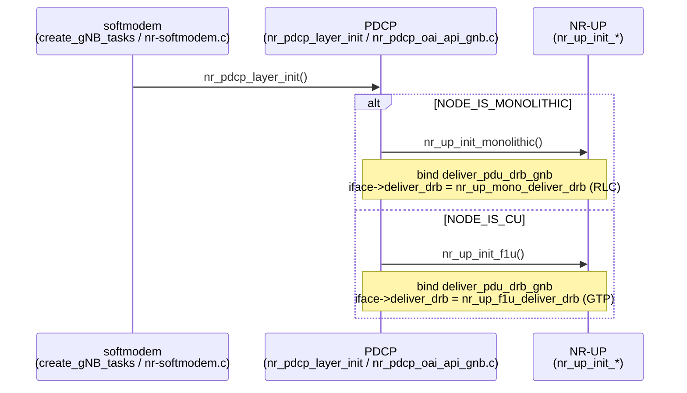
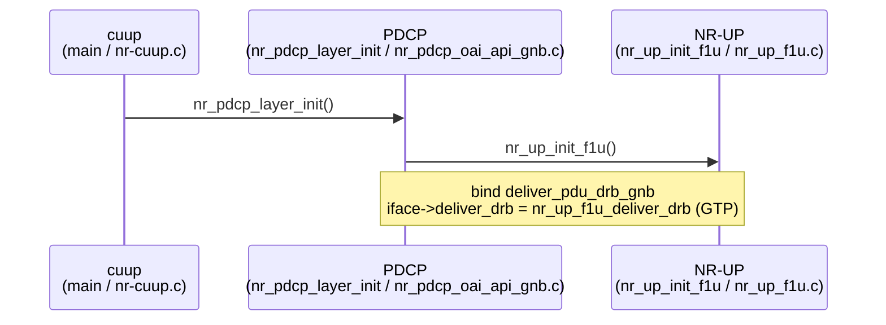
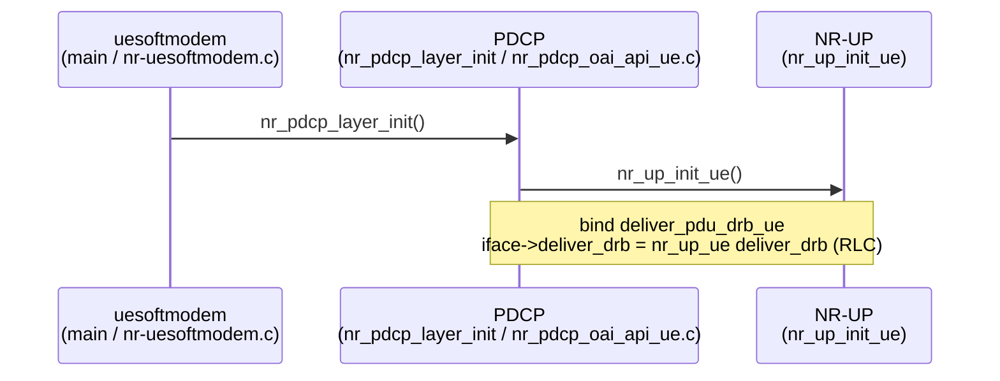
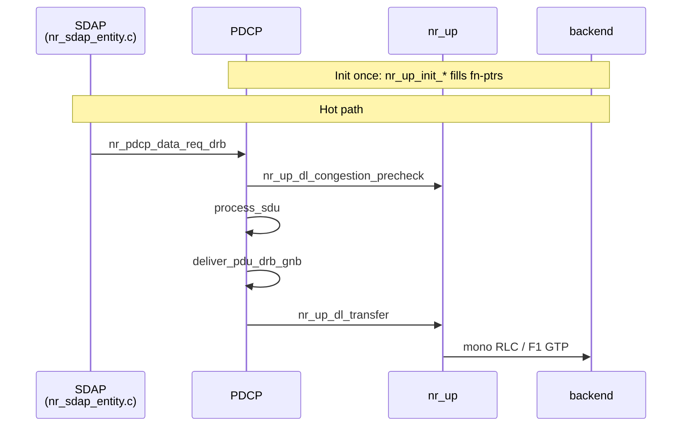

## Problem with current MR shape

PDCP split into `nrup_{direct,f1ap,ue,handler}`. F1 vs direct is an **nr-up** concern, not PDCP.

---

## Target in a nutshell

**Summary:**
* PDCP calls nr-up only
* F1/direct chosen at `nr_up_init_*`
* no `nrup_direct` / `nrup_f1ap` PDCP splits
* Extra: UE also adopts nr-up for symmetry

---

## PDCP split: gNB vs UE

**PDCP design:** two libs only, `nr_pdcp_gnb` and `nr_pdcp_ue`, linked by CMake. Both share `nr_pdcp_oai_api.c` plus thin role TUs (`nr_pdcp_oai_api_gnb.c` / `_ue.c`) that own `deliver_pdu_drb_gnb` / `_ue` and call `nr_up_init_*`. Mono and F1/CU use the same gNB PDCP and the same deliver; only the nr-up backend differs (`nr_up_direct` vs `nr_up_f1ap`). Drop `nr_pdcp_nrup_{direct,f1ap,handler,ue}.c`.

Note: core = `nr_pdcp_entity.c`, `nr_pdcp_ue_manager.c`, `nr_pdcp_sdu.c`, `nr_pdcp_timer_thread.c`, security/integrity (`nea*` / `nia*`), `asn1_utils.c`

| | Mono | F1 / CU | UE |
|--|------|---------|-----|
| **PDCP lib** | `nr_pdcp_gnb` | `nr_pdcp_gnb` | `nr_pdcp_ue` |
| **Deliver** | `deliver_pdu_drb_gnb` | `deliver_pdu_drb_gnb` | `deliver_pdu_drb_ue` |
| **nr-up** | `nr_up_direct` | `nr_up_f1ap` | `nr_up_ue` |

---

## How selected

* Guideline: **no PDCP role macros**
* gNB vs UE PDCP: CMake links `nr_pdcp_gnb` or `nr_pdcp_ue`
* mono vs F1 on softmodem: same binary links both backends (`nr_up_f1ap`, `nr_up_direct`), runtime `NODE_IS_*` picks init
* `nr-cuup`: links `nr_up_f1ap` only

### Linkage

### Init call chains

**nr-softmodem** (mono or F1: same entry, different `nr_up_init_*`)

**nr-cuup**

**nr-uesoftmodem**

---

## Sequence diagram

**Same API, different `deliver_drb`:** `nr_up_dl_transfer()` always dispatches `iface->deliver_drb`.

| | Mono | F1 (CU) |
|--|------|---------|
| Init | `nr_up_mono_deliver_drb` + precheck | `nr_up_f1u_deliver_drb` (+ precheck) |
| Transfer | RLC queue + consume | GTP send (+ consume) |

| Concern | Owner | Detail |
|---------|--------|--------|
| Congestion precheck **call** | PDCP | `nr_pdcp_data_req_drb` calls `nr_up_dl_congestion_precheck` before SN. |
| Deliver bind | PDCP | `drb_deliver = deliver_pdu_drb_*` at init, calls `nr_up_dl_transfer` |
| Congestion **policy** | nr-up backend | `iface->dl_congestion_precheck`: compare PDU size to cached **`available_tx_bytes`** (mono: from RLC TX space, F1: from DDDS `desired_buffer_size`). Stale cache (ALLOW after ~3 s) |
| RLC or GTP send + consume | nr-up backend | `iface->deliver_drb` |
| TS 38.425 lib | `nrup_lib` | encode/decode only |
