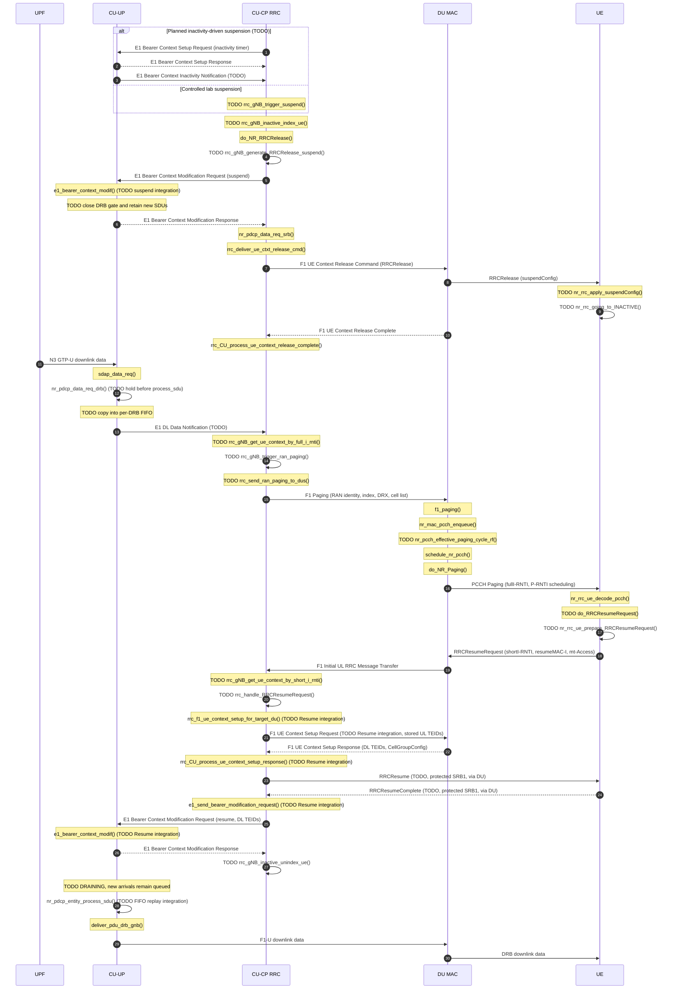

# RAN-initiated paging design

High level path: **CONNECTED -> INACTIVE -> RAN paging -> Resume -> downlink delivery**.

CU mantains UE-associated NG connection and CU context while releasing DU radio resources. The UE remains CM-CONNECTED. [TS 38.300 §9.2.2.1][TS 38.300]
If serving gNB changes: Xn context retrieval / NGAP Path Switch.

CU-UP shall configure inactivity monitoring during bearer setup. When CU-UP reports inactivity with E1 Bearer Context Inactivity Notification, let CU-CP decide whether to suspend the UE ([TS 38.401 §8.9.6.1, steps 1–4][38.401]; [TS 38.331 §§5.3.8.1–3][38.331]; [TS 38.300 §9.2.2.1][38.300].)

| Step | Description | 3GPP |
|---|---|---|
| 1 | TODO: configure and consume inactivity timers at CU-UP during bearer setup, because CU-UP observes user-plane traffic. | [38.401 §8.9.6.1, step 1][38.401] |
| 2 | TODO: | [38.401 §8.9.6.1, step 2][401]. |
| 3 | TODO: generate, transport and handle the inactivity notification. Release policy at CUCP. | [38.401 §8.9.6.1, steps 3–4][38.401]; [38.331 §5.3.8.2][38.331]. |
| 4 | CUCP decides to suspend: retain AS/bearer/NG context and allocate fresh 40-bit full and 24-bit short I-RNTIs. Add the same UE context to the inactive full-I-RNTI tree before sending Release. Short-I-RNTI lookup shall be unambiguous. Call `do_NR_RRCRelease()` with `suspendConfig`. | [38.300 §9.2.2.1][38.300]; [38.331 §5.3.8, §6.3.2 SuspendConfig][38.331]; [33.501 §6.8.2.1.2][33.501]. |
| 5 | TODO: extend CU-UP bearer-modification handling to apply the suspend command and close its DRB transmission before removing the DU endpoint. Retain bearer context, N3 endpoint and F1-U UL TEIDs. | [38.401 §8.9.6.1, steps 5–6][38.401] |
| 7 | `RRCRelease` through SRB1 PDCP and carry it in the F1 release command, so the DU can deliver the final RRC message. | [33.501 §6.8.2.1.2][33.501]; [38.473 §8.3.3.2][38.473]. |
| 8 | Deliver `RRCRelease(suspendConfig)` to tell the UE to suspend while retaining the information needed to resume. | [38.331 §5.3.8.3][38.331]. |
| 9 | Save inactive AS context, including source PCI/C-RNTI and security state. reset MAC, suspend bearers except SRB0, apply paging configuration and notify upper layers of suspension. Set the UE's `nrRrcState = RRC_STATE_INACTIVE_NR` and keep camping and paging monitoring active. | [38.331 §5.3.8.3][38.331]; [33.501 §6.8.2.1.2][33.501]. |
| 10 | Acknowledge DU resource release. Preserve the inactive CU/NG context. | [38.473 §8.3.3.2][38.473]; [38.300 §9.2.2.1][38.300]. |
| 11 | Receive downlink data on the retained N3 tunnel: the UPF can still reach the CU-UP while the UE is inactive. | [38.401 §8.9.6.2, step 0][38.401]. |
| 12 | TODO: `nr_pdcp_data_req_drb()` retain suspended-DRB SDUs in a CU-UP-owned FIFO before calling PDCP `process_sdu`. At this point SDAP has selected the DRB and constructed any SDAP header. Copy the SDU in the queue. | [38.401 §8.9.6.2][38.401] |
| 13 | TODO: activity information through E1 DL Data Notification ? CU-CP resolves its retained RRC context and pages. | [38.401 §8.9.6.2, step 1][38.401]; [38.300 §9.2.2.4.2][38.300]. |
| 15 | Send out to DUs serving the configured RNA. | [38.473 §8.7.1][38.473]; [38.300 §9.2.2.1][38.300]. |
| 16 | Queue and transmit full I-RNTI on PCCH at the UE's PF/PO, with P-RNTI scheduling. `nr_pcch_effective_paging_cycle_rf()` to combine the cell default with the queued F1 UE-specific DRX before deriving PF/PO | [38.331 §5.3.2, §6.2.2 Paging][38.331]; [38.304 §7.1][38.304]. |
| 17 | Match full I-RNTI while inactive and prepare `mt-Access` Resume. Start T319, restore the required context, compute `resumeMAC-I`, derive fresh AS keys and resume SRB1 so a protected response can be received. | [38.331 §§5.3.2.3, 5.3.13.2–3][38.331]. |
| 18 | Send the short I-RNTI Resume request on SRB0 through random access. This reconnects a UE without an active radio connection. | [38.331 §5.3.13.3][38.331]; [33.501 §§6.8.2.1.3–4][33.501]. |
| 19 | Forward the request, target cell and new DU UE identity to CU-CP, which holds the inactive context. | [38.473 §8.4.1][38.473]; [38.401 §8.9.6.2, step 5][38.401]. |
| 20 | TODO: context via `resumeMAC-I` verification, key derivation and rebind to the new C-RNTI/DU identity. | [33.501 §§6.8.2.1.3–4][33.501]; [38.331 §5.3.13.3][38.331]. |
| 21 | TODO Resume:  `rrc_f1_ue_context_setup_for_target_du()` to recreate SRB/DRB resources from retained context and CU-UP UL TEIDs. | [38.401 §8.9.6.2, step 6][38.401]; [38.473 §8.3.1][38.473]. |
| 22 | TODO Resume: `rrc_CU_process_ue_context_setup_response()` to collect new DL TEIDs/CellGroupConfig and continue with `RRCResume`. | [38.401 §8.9.6.2, step 7][38.401]; [38.473 §8.3.1][38.473]. |
| 23 | TODO: implement `RRCResume` encoder, delivery and UE reception handler. Apply the radio configuration, stop T319/T380, resume bearers and enter CONNECTED. | [38.331 §5.3.13.4][38.331]; [33.501 §§6.8.2.1.3–4][33.501]. |
| 24 | TODO: implement UE `RRCResumeComplete` encoding/transmission and gNB UL-DCCH dispatch/handling. Stop paging and reset its attempt count when the departure from INACTIVE is confirmed. Notify UE upper layers of resumption. | [38.331 §5.3.13.4][38.331]; [33.501 §6.8.2.1.3][33.501]; [38.300 §9.2.5][38.300] for the counter reset. |
| 25 | TODO: extend bearer-modification handling to restore PDCP/security state and new DL TEIDs at CU-UP. | [38.401 §8.9.6.2, step 9][38.401] |
| 26 | Return success only after CU-UP applies the restored bearer configuration, otherwise keep the queue and report failure. | [38.401 §8.9.6.2, step 10][38.401] |
| 27 | After validation, remove the secondary I-RNTI entry | |
| 28 | Replay each CU-UP FIFO through the restored PDCP `process_sdu` callback. | [38.401 §8.9.6.2][38.401]; [38.331 §5.3.13.3][28.331]. |
| 29 | Forward buffered data on the restored F1-U tunnel to the selected DU. | [38.401 §8.9.6.2, steps 6–10][38.401]. |
| 30 | Deliver downlink data over the resumed DRB. | [38.331 §5.3.13.4][38.331]. |

## RRC state tracking

**CU-CP:** `rrc_gNB_ue_context_t` in two RB trees:
* `rrc_ue_head` keyed by `rrc_ue_id`
* `rrc_ue_inactive_irnti_head` keyed by `full_i_rnti`

**UE:** 
* `nr_rrc_going_to_INACTIVE()` sets `nrRrcState = RRC_STATE_INACTIVE_NR`, retaining context while INACTIVE

No design doc file exists in this worktree (it lives outside the tree), so here is the condensed section as text you can paste. I checked the two facts it leans on: `nr_pdcp_data_req_drb()` calls `rb->process_sdu()` at `nr_pdcp_oai_api.c:650`, and `nr_pdcp_entity_process_sdu()` bails on `entity_suspended` (`nr_pdcp_entity.c:43`).

---

## Buffering until Resume (CU-UP)

Buffering needs a per-bearer FIFO whose elements carry payload.

Approach: `common/utils/collection/queue.h` - `STAILQ_HEAD`, `STAILQ_ENTRY`, `STAILQ_INSERT_TAIL`, `STAILQ_FIRST`, `STAILQ_REMOVE_HEAD`  as GTP-U, F1 and E1 task threads can be producers 

